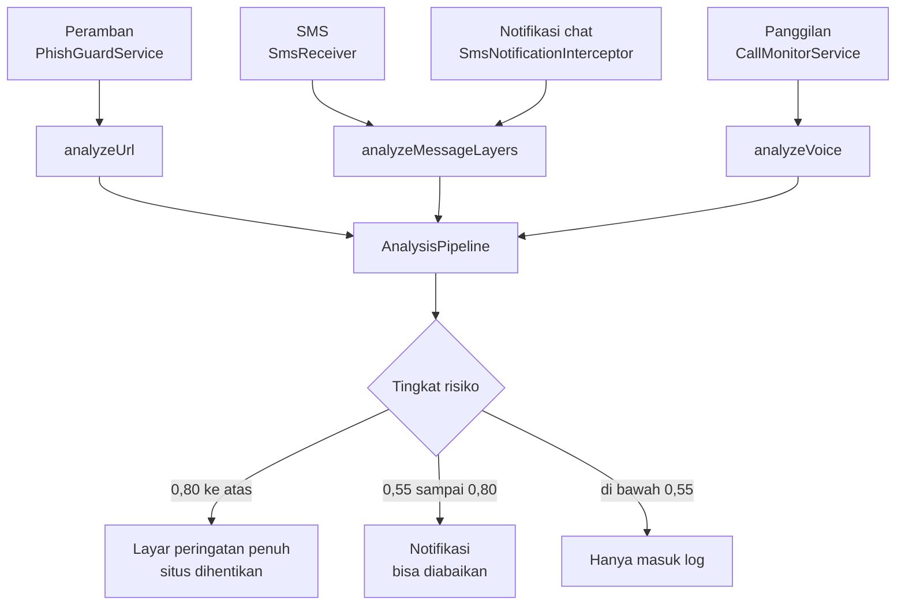

# PhishGuard AI

Aplikasi Android pelindung dari penipuan digital untuk pengguna Indonesia.
Memantau tautan di peramban, pesan SMS/chat, notifikasi, dan panggilan
telepon, lalu memperingatkan pengguna sebelum data atau uangnya berpindah
tangan.

Dirancang dengan satu prinsip yang mengikat semua keputusan teknisnya:
**peringatan palsu sama merusaknya dengan ancaman yang terlewat.** Peringatan
yang terlalu sering salah akan berhenti dibaca, dan sejak itu aplikasinya
tidak lagi melindungi siapa pun.

---

## Daftar isi

- [Kemampuan](#kemampuan)
- [Cara kerja deteksi](#cara-kerja-deteksi)
  - [Empat kanal masuk](#empat-kanal-masuk)
  - [Pipeline URL](#pipeline-url)
  - [Skoring risiko berbobot](#skoring-risiko-berbobot)
  - [Respons bertingkat](#respons-bertingkat)
  - [Pipeline pesan tiga lapis](#pipeline-pesan-tiga-lapis)
- [Blocklist luring 4,1 juta domain](#blocklist-luring-41-juta-domain)
- [Angka yang terukur](#angka-yang-terukur)
- [Membangun proyek](#membangun-proyek)
- [Membuat APK rilis](#membuat-apk-rilis)
- [Menyiapkan aplikasi di perangkat](#menyiapkan-aplikasi-di-perangkat)
- [Catatan untuk pengembang](#catatan-untuk-pengembang)
- [Struktur proyek](#struktur-proyek)
- [Memperbarui blocklist](#memperbarui-blocklist)
- [Keamanan basis data komunitas](#keamanan-basis-data-komunitas)
- [Menyetel ambang deteksi](#menyetel-ambang-deteksi)
- [Pengujian](#pengujian)
- [Batasan yang diketahui](#batasan-yang-diketahui)
- [Sebelum rilis](#sebelum-rilis)
- [Riwayat perubahan penting](#riwayat-perubahan-penting)
- [Kredit](#kredit)

---

## Kemampuan

| Kanal | Yang dipantau | Mekanisme Android |
|---|---|---|
| **Peramban** | URL yang dibuka di 24 peramban dan WebView dalam aplikasi | `AccessibilityService` |
| **SMS** | Pesan masuk di aplikasi pesan bawaan | `BroadcastReceiver` |
| **Chat & notifikasi** | WhatsApp, Telegram, Messenger, Instagram | `NotificationListenerService` |
| **Panggilan** | Transkripsi percakapan secara langsung (bahasa Indonesia) | `SpeechRecognizer` + `ForegroundService` |

Ditambah:

- **Deteksi judi online (judol)** — jargon judi pada nama domain maupun isi
  halaman, dikalibrasi dari 1,8 juta domain judi sungguhan.
- **Basis data komunitas** — situs yang dikonfirmasi pengguna diunggah ke
  Firestore, lalu tersinkron ke pengguna lain lewat penomoran versi.
- **Human-in-the-loop** — pengguna selalu bisa membantah vonis sistem, dan
  keputusan itu diingat lintas sesi.
- **Bekerja luring** — pemeriksaan blocklist dan seluruh heuristik berjalan
  tanpa jaringan.

---

## Cara kerja deteksi

### Empat kanal masuk



### Pipeline URL

`AnalysisPipeline.analyzeUrl` memeriksa berurutan, dari yang paling pasti ke
yang paling menebak. Urutannya disengaja — pemeriksaan yang bisa keliru
selalu ditaruh **setelah** daftar putih, supaya kekeliruannya tidak pernah
mengenai situs tepercaya.

| # | Langkah | Sumber | Bila cocok |
|---|---|---|---|
| 1 | URL persis di database phishing lokal | Room | ancaman, 1,00 |
| 2 | Domain resmi (BCA, BRI, OJK, Tokopedia, …) | Room, `DatabaseSeeder` | **aman, berhenti** |
| 3 | Hostname di database phishing lokal | Room | ancaman, ≥0,90 |
| 4 | Domain di blocklist global | `DomainBlocklist` (Bloom) | ancaman, 0,95 |
| 5 | Skoring heuristik | `UrlRiskScorer` | sesuai skor |

Langkah 3 sengaja **melewati host besar dan hosting berbagi-pakai**
(`google.com`, `blogspot.com`, `github.io`, …). Umpan publik melaporkan URL
abusif yang menumpang di host sah — PhishTank pernah melaporkan
`google.com/share.google?q=…`, dan entri itu tersimpan dengan
`domain="google.com"`. Tanpa pengecualian ini, satu laporan semacam itu
membuat **seluruh** google.com divonis phishing; terbukti terjadi di
perangkat uji. URL persisnya tetap diblokir lewat langkah 2.

Sebelum masuk pipeline, `PhishGuardService` membersihkan masukannya:

- **Menyaring yang bukan URL.** Bilah alamat juga memuat kueri pencarian dan
  judul halaman; menganalisisnya sebagai URL hanya melahirkan peringatan
  palsu.
- **Membuka bungkus pengalih.** `google.com/amp/s/<domain-asli>` dan
  `apa-saja.com/go?url=<domain-asli>` dibongkar dulu, supaya deteksi menilai
  host yang sebenarnya, bukan pembungkusnya yang tampak aman.

### Skoring risiko berbobot

Inti perlindungan terhadap peringatan palsu ada di `UrlRiskScorer`. Setiap
sinyal hanya **menyumbang** bobot; hanya akumulasinya yang bertindak. Satu
sinyal lemah tidak pernah cukup.

| Sinyal | Bobot | Catatan |
|---|---|---|
| Istilah judi pada hostname | 0,72 | tidak memblokir sendirian — "slot"/"toto" ada di domain sah |
| Peniruan brand | 0,75 | 0,45 untuk brand yang juga kata umum (`dana`, `grab`) |
| Isi halaman promosi judi | 0,60 | butuh istilah judi kuat, bukan sekadar "bonus" |
| Alamat IP mentah | 0,55 | |
| Domain punycode (`xn--`) | 0,50 | huruf yang menyerupai latin |
| Tanda `@` menyembunyikan tujuan | 0,40 | |
| Brand disebut di path, bukan host | 0,40 | `situs-acak.com/bca/login` |
| Kata sensitif di **hostname** | 0,35 | |
| TLD yang terbukti disalahgunakan | 0,30 | dikalibrasi dari data, lihat di bawah |
| 4+ tanda hubung | 0,30 | 3 tanda hubung 0,18; **2 tidak dihitung** |
| Menumpang hosting gratis | 0,25 | |
| Subdomain ≥6 tingkat | 0,22 | |
| Domain didominasi angka | 0,20 | |
| Nama domain >45 karakter | 0,15 | |
| Kata sensitif di **path** | 0,12 | sengaja kecil — hampir semua situs punya `/login` |

Istilah judi juga dipisah dua tingkat. Yang **tidak ambigu** (`gacor`,
`sbobet`, `casino`, `maxwin`) langsung memvonis begitu cocok. Yang **ambigu**
(`slot`, `toto`, `rtp`, `olympus`) butuh dua sinyal, karena sendirian ia
menjerat usaha sah: `toto.co.jp` adalah produsen sanitasi Jepang,
`slotcarshop.com` toko mainan, `rtp.pt` penyiar nasional Portugal. Domain
judol asli hampir selalu menumpuk beberapa istilah sekaligus
(`totoslot88`, `rtpslotgacor`), jadi deteksinya tidak berkurang — yang
hilang hanya salah tangkapnya.

Pencocokan brand **tidak pernah memakai substring bebas**. Yang diterima
hanya token utuh (`bca`), token dengan afiks yang dikenal (`klikbca`,
`bankbri`, `bca123`), atau typosquat berjarak edit 1 untuk brand ≥5 huruf
(`tokopedla`). Aturan inilah yang membedakan `bri-mobile.xyz` dari
`bridge.com`.

### Respons bertingkat

Peringatan yang salah tidak boleh menjegal pengguna:

| Skor | Tindakan |
|---|---|
| **≥ 0,80** | Layar peringatan penuh dengan tombol **"Laporkan dan keluar dari situs ini"**. Setelah ditekan, peramban dikembalikan satu halaman — bukan ditutup — dengan jeda 3,5 detik agar halaman yang memuat ulang tidak memicu peringatan berulang. |
| **0,55 – 0,80** | Notifikasi biasa. Penjelajahan berjalan terus; pengguna bisa membuka detail bila ingin memblokir. |
| **< 0,55** | Hanya dicatat di log aktivitas. |

Keputusan pengguna disimpan permanen. Menandai satu situs "aman" berarti ia
tidak akan diperingatkan lagi, bahkan setelah aplikasi dimulai ulang.

### Pipeline pesan tiga lapis

`analyzeMessageLayers` memeriksa SMS dan chat berlapis, berhenti di lapisan
pertama yang menemukan ancaman:

1. **Tautan** — setiap URL dalam pesan diadu ke database lokal, daftar putih,
   blocklist global, lalu skoring heuristik.
2. **Pengirim** — nomor pengirim dicocokkan ke database nomor penipu.
3. **Isi pesan** — mesin aturan berbobot pada teks lengkapnya.

Pada lapisan isi, pola dibagi dua kelas. Pola **kuat** khas penipuan
(`unduh apk`, `kode otp anda`, `rekening anda diblokir`) bisa berdiri
sendiri. Pola **lemah** yang juga lazim di pesan sah (`install aplikasi`,
`undangan pernikahan`, `bit.ly`) tidak pernah memicu peringatan sendirian.

Tapi pola lemah **menumpuk** juga berarti sesuatu. Tiga pola lemah dari
minimal dua kategori berbeda sudah cukup jadi titik awal. Tanpa aturan ini,
scam bergaya lunak yang paling lazim di WhatsApp lolos total — pesan seperti
*"Selamat! Anda dapat hadiah 100 juta, klik link berikut dan install
aplikasinya"* tidak memuat satu pun frasa kuat, sehingga skornya nol.
Satu atau dua pola lemah tetap tidak berarti apa-apa.

---

## Blocklist luring 4,1 juta domain

Sumber: [**Lyra** — ITSEC Research](https://github.com/ITSEC-Research/Lyra),
agregat blocklist yang diperbarui harian.

Lyra bukan dataset pelatihan model — isinya daftar domain teks polos.
Jadi ia dipakai untuk dua hal yang memang cocok untuk data seperti itu:
**dikemas** agar bisa dicek luring, dan **statistiknya dipakai
mengkalibrasi** ambang yang tadinya hanya tebakan.

### Pengemasan

Mentahnya lebih dari 80 MB — mustahil dibawa di ponsel. Bloom filter
memampatkan 4.108.088 domain (phishing/scam, malware/C2, judi) menjadi
**9,4 MB** dengan pencarian O(1) tanpa jaringan.

Asetnya dipetakan ke memori (`mmap`) langsung dari APK, bukan dibaca ke
heap — karena itu `bloom` masuk daftar `noCompress` di `build.gradle.kts`.
Bila asetnya tidak ada, aplikasi tetap berjalan dengan heuristik saja.

> **Sifat Bloom filter:** ia bisa keliru menyatakan sebuah domain terdaftar,
> tapi tidak pernah sebaliknya. Peluangnya disetel 0,01% dan terukur 0,0085%.
> Domain resmi diperiksa lebih dulu, jadi kekeliruan itu tidak akan mengenai
> situs tepercaya.

### Penyaringan derau

Uji pertama menunjukkan 6% domain populer ikut tertandai. Itu bukan galat
Bloom filter, melainkan isi umpan Lyra sendiri: kategori `suspicious` dan
`malicious` menyertakan banyak domain adtech dan hosting populer
(`1rtb.com`, `000webhost.com`, `3322.net`).

Solusi naifnya — membuang semua domain populer — justru salah, karena akan
meloloskan `1xbet.com`, `1win.com`, dan `bet365.com`; padahal memblokir
mereka memang tujuan aplikasi ini. **Popularitas bukan bukti keabsahan untuk
judi.** Karena itu penyaringannya dibedakan per kategori:

| Kategori | Kebijakan |
|---|---|
| `suspicious`, `malicious` | 50.000 domain terpopuler (Tranco) disaring keluar — domain phishing sungguhan tidak pernah mencapai peringkat setinggi itu |
| `gambling` | Domain populer **dipertahankan**, kecuali namanya tidak mengandung jargon judi sama sekali — sehingga `dribbble.com` dan `mundodeportivo.com` yang tersapu umpan longgar ikut lepas |

Hasilnya: domain populer yang tertandai turun dari **6,02% → 0,45%**, dan
sisanya seluruhnya operator taruhan sungguhan.

### Kalibrasi aturan

Dari perbandingan 4,1 juta domain jahat dengan Tranco top 1M sebagai acuan
domain sah, dihitung *lift* tiap TLD — pangsanya di daftar jahat dibagi
pangsanya di daftar populer:

| TLD | lift | TLD | lift |
|---|---:|---|---:|
| `.tk` | 88× | `.click` | 21× |
| `.gdn` | 86× | `.sbs` | 18× |
| `.stream` | 82× | `.lol` | 17× |
| `.digital` | 37× | `.cyou` | 13× |

Daftar lengkapnya ada di [`tools/blocklist_report.md`](tools/blocklist_report.md).

Beberapa terlihat tidak berbahaya (`.digital`, `.store`, `.site`) tapi
terbukti disalahgunakan berlipat kali. Itu aman diadopsi justru **karena**
arsitektur skoringnya: TLD hanya menyumbang 0,30 dan tidak pernah memblokir
sendirian.

Untuk jargon judi, `rtp` (lift 177×), `gacor` (86×), dan `mpo` (57×)
diambil. Yang **sengaja ditolak** meski lift-nya tinggi: kata Indonesia umum
seperti `daftar`, `situs`, `klik`, `cuan`, `menang`. Lift-nya tampak tinggi
hanya karena acuan Tranco global cuma memuat 5.035 domain `.id` — itu
kekurangan sampel, bukan bukti. Memakainya akan memblokir situs lokal yang
wajar. Nama merek judi juga tidak masuk daftar kata: domain persisnya sudah
ditangani Bloom filter, sedangkan daftar kata bertugas menebak domain yang
**belum** terdaftar.

---

## Angka yang terukur

Diukur pada aset yang saat ini ada di repositori:

| Metrik | Nilai |
|---|---|
| Domain di blocklist | 4.108.088 |
| Ukuran aset | 9,4 MB (mentah >80 MB) |
| Deteksi kategori judi | 100,00% |
| Deteksi kategori malware | 99,95% |
| Deteksi kategori phishing | 99,60% |
| False positive Bloom filter | 0,0085% (target 0,01%) |
| Domain populer tertandai | 0,45% (dari 6,02% sebelum penyaringan) |
| Ukuran APK debug | 35,2 MB |

Untuk mereproduksi, jalankan ulang `tools/build_blocklist.py` — ia mencetak
angka-angka ini ke `tools/blocklist_report.md`.

---

## Membangun proyek

**Prasyarat**

- Android SDK — `compileSdk 36`, `targetSdk 36`, `minSdk 24` (Android 7.0)
- JDK 11 (`sourceCompatibility`/`targetCompatibility` = 11)
- Gradle 9.2.1 (tersedia lewat wrapper)
- AGP 9.0.1, Kotlin 2.1.20

**Langkah**

```bash
git clone https://github.com/Defen21/Project-M.git
cd Project-M

# Arahkan ke Android SDK
echo "sdk.dir=$HOME/Android/Sdk" > local.properties

./gradlew assembleDebug
# → app/build/outputs/apk/debug/app-debug.apk
```

**Firebase.** `google-services.json` sengaja tidak dilacak git. Untuk
membangun proyek, letakkan berkas milikmu sendiri di `app/`. Tanpa itu
langkah `processDebugGoogleServices` akan gagal. Firestore hanya dipakai
untuk basis data komunitas — seluruh deteksi tetap berjalan tanpanya.

Minimal skema Firestore yang dipakai:

```
metadata/versions       { phishing_version, official_version }
phishing_urls/{hash}    { url, reason, confidence, reported_count, timestamp }
official_urls/{hash}    { domain, brand, category, timestamp }
```

---

## Membuat APK rilis

```bash
./gradlew assembleRelease
# → app/build/outputs/apk/release/app-release.apk
```

**Kunci penandatangan.** Build release memakai `phishguard-release.jks`
dengan kredensial di `keystore.properties`. Keduanya **tidak dilacak git**
dan tidak boleh masuk repo. Bila `keystore.properties` tidak ada, build
tetap berjalan tapi keluarannya belum ditandatangani dan tidak bisa
dipasang.

> **Simpan kunci itu baik-baik.** Android mengikat identitas aplikasi ke
> sertifikat penandatangannya. Kalau kuncinya hilang, pengguna yang sudah
> memasang versi lama **tidak bisa memperbarui** — mereka harus mencopot
> dulu, dan seluruh data lokalnya ikut hilang.

**Sidik jari kunci tertanam di aplikasi.** `AppIntegrityChecker` mencocokkan
sertifikat penandatangan dengan `EXPECTED_SIGNATURE_HASH`, sehingga APK yang
ditandatangani ulang orang lain menolak berjalan. Kalau kunci diganti, nilai
itu **wajib** ikut diganti — kalau tidak, build release berikutnya menolak
dirinya sendiri.

**ProGuard.** Empat kelas dicari lewat `Class.forName` saat runtime, jadi
namanya tidak boleh diobfuscate. Aturannya ada di `app/proguard-rules.pro`.
Aturan itu sempat menunjuk paket lama `com.example.ai_project_singapore`
selama berbulan-bulan setelah refactor — akibatnya tidak satu pun berlaku,
dan build release akan menutup diri sendiri dengan dialog "aplikasi telah
dimodifikasi" begitu dibuka. Kalau ada kelas baru yang dicari lewat nama,
tambahkan `-keep`-nya di sana.

## Menyiapkan aplikasi di perangkat

Tiga izin di bawah **tidak bisa** diminta lewat dialog biasa dan harus
dinyalakan pengguna sendiri di Pengaturan:

1. **Layanan Aksesibilitas** — Pengaturan → Aksesibilitas → PhishGuard AI.
   Tanpa ini pemantauan peramban dan chat tidak berjalan sama sekali.
2. **Akses Notifikasi** — Pengaturan → Akses notifikasi → PhishGuard AI.
   **Tanpa ini deteksi WhatsApp, Telegram, dan chat lain sama sekali tidak
   berjalan** — `SmsNotificationInterceptorService` tidak pernah hidup, jadi
   tidak ada notifikasi yang sampai ke aplikasi. Ini penyebab paling sering
   ketika orang melaporkan "deteksi WhatsApp tidak jalan"; hampir selalu
   izinnya yang belum diberikan, bukan bugnya.
3. **Tampilkan di atas aplikasi lain** — pada sebagian ROM (Xiaomi, Oppo,
   Vivo) diperlukan agar layar peringatan bisa muncul di atas peramban.

Izin SMS, telepon, mikrofon, dan notifikasi diminta otomatis saat aplikasi
pertama dibuka.

> **Catatan untuk pengujian lewat adb.** Sebagian ROM (terverifikasi di Vivo
> OriginOS, Android 14) menolak pengaktifan layanan aksesibilitas lewat
> `settings put secure enabled_accessibility_services` — nilainya dikembalikan
> ke `null` beberapa detik kemudian. Itu proteksi ROM terhadap malware
> aksesibilitas, bukan bug aplikasi. Togglenya harus ditekan langsung di layar.
> Perlu diingat juga: `adb shell am force-stop` dan pemasangan ulang APK
> sama-sama mematikan layanan aksesibilitas, jadi ia harus dinyalakan lagi
> setiap selesai `installDebug`.

> **Catatan privasi.** Seluruh analisis berjalan di perangkat. Yang keluar
> hanya URL yang **secara eksplisit dikonfirmasi pengguna** sebagai penipuan,
> dan itu dikirim ke Firestore untuk melindungi pengguna lain. Riwayat
> penjelajahan tidak pernah dikirim ke mana pun; siaran log internal pun
> dibatasi ke paket aplikasi sendiri agar tidak terbaca aplikasi lain.

---

## Catatan untuk pengembang

**Sistem notifikasi dibekukan.** `SmsNotificationInterceptorService` dan
jalur peringatan notifikasinya sudah berfungsi dan diverifikasi di
perangkat. Jangan diubah tanpa permintaan eksplisit — termasuk daftar paket
yang dipantau, ambang keyakinan, dan bentuk notifikasi penggantinya.
Perbaikan deteksi sebaiknya dilakukan di lapisan analisis
(`TFLiteMessageProvider`, `AnalysisPipeline`), bukan di jalur notifikasinya.

Isi pesan **tidak boleh** dicetak ke log. Notifikasi chat adalah percakapan
pribadi pengguna, dan siapa pun yang bisa membaca logcat ikut membacanya.
Catat panjang atau kategorinya saja.

## Struktur proyek

```
app/src/main/java/com/phishguard/ai/
├── PhishGuardService.kt          AccessibilityService — pemantau peramban & chat
├── MainActivity.kt               Kerangka UI, izin runtime, cek integritas
├── core/ai/
│   ├── AnalysisPipeline.kt       Orkestrator: DB lokal → daftar putih → blocklist → AI
│   ├── AIModelProvider.kt        Antarmuka provider (bisa ditukar)
│   ├── UrlRiskScorer.kt          Skoring berbobot — murni Kotlin, teruji
│   ├── DomainBlocklist.kt        Pembaca Bloom filter (mmap)
│   ├── JudolWordlist.kt          Kata penanda judi berbobot
│   ├── LstmUrlProvider.kt        Provider URL, menjembatani DB ke scorer
│   ├── TFLiteMessageProvider.kt  Mesin aturan pesan (siap diganti TFLite)
│   ├── DefaultRuleProvider.kt    Analisis suara
│   ├── CallFraudDetector.kt      Speech-to-text + analisis berjendela
│   └── MessageAnalyzer.kt        Pembungkus untuk pencegat notifikasi
├── core/network/
│   ├── FirebaseSyncManager.kt    Sinkronisasi berbasis versi + unggah komunitas
│   ├── ServerSyncManager.kt      Umpan publik OpenPhish & PhishTank
│   └── ApiClient.kt              Klien HTTP
├── core/security/
│   └── AppIntegrityChecker.kt    Verifikasi tanda tangan & anti-utak-atik
├── data/db/                      Room: phishing_urls, phishing_numbers, official_urls
├── receiver/SmsReceiver.kt       SMS masuk
├── service/                      Pemantau panggilan, pencegat notifikasi
└── ui/                           Dashboard, Proteksi, Aktivitas, Pengaturan, Peringatan

app/src/main/assets/
├── blocklist.bloom               Bloom filter 4,1 juta domain (9,4 MB)
└── official_data.txt             Benih domain resmi

tools/
├── build_blocklist.py            Pembangun aset + pengkalibrasi aturan
└── blocklist_report.md           Hasil kalibrasi terakhir
```

---

## Memperbarui blocklist

Lyra diperbarui harian. Untuk menyegarkan aset:

```bash
git clone --depth 1 https://github.com/ITSEC-Research/Lyra.git /tmp/Lyra
curl -sLO https://tranco-list.eu/top-1m.csv.zip

python3 tools/build_blocklist.py \
    --lyra /tmp/Lyra \
    --tranco top-1m.csv.zip
```

Menghasilkan `app/src/main/assets/blocklist.bloom` dan laporan kalibrasi di
`tools/blocklist_report.md`. Tinjau laporannya sebelum commit — di situlah
usulan `CHEAP_TLDS` dan kata penanda judi yang baru muncul.

Opsi yang tersedia:

| Opsi | Bawaan | Guna |
|---|---|---|
| `--fpr` | `0.0001` | Target false positive. Menaikkannya memperkecil aset. |
| `--exclude-top` | `50000` | Berapa domain terpopuler yang disaring dari kategori suspicious/malicious. |
| `--out` | `app/src/main/assets/blocklist.bloom` | Lokasi aset keluaran. |

> **Perhatian ukuran repositori.** Aset 9,4 MB ini dilacak git. Bila hendak
> menyegarkannya sering-sering, pertimbangkan Git LFS atau mengunduhnya saat
> aplikasi pertama dijalankan — kalau tidak, histori repositori akan tumbuh
> ~9,4 MB setiap pembaruan.

---

## Keamanan basis data komunitas

Saat pengguna menekan "blokir", URL-nya diunggah ke Firestore agar pengguna
lain ikut terlindungi. Ada dua konsekuensi yang perlu dipahami sebelum
memakainya di produksi.

**Konfigurasi Firebase ikut terbundel di setiap APK.** `google-services.json`
memang dirancang untuk itu, tapi artinya siapa pun bisa mengekstraknya dan
memakai kunci yang sama. Karena aplikasi ini menulis ke Firestore **tanpa
autentikasi sama sekali** (tidak ada `FirebaseAuth` di kode), aturan
Firestore-nya harus mengizinkan tulisan anonim supaya fitur laporan berfungsi.
Konsekuensinya, laporan bisa datang dari mana saja — bukan hanya dari
aplikasi.

Sampai 20 Agustus 2026 aturan yang berlaku di produksi adalah bawaan
pengembangan — `allow read, write: if true` untuk seluruh database. Siapa
pun bisa membaca, menulis, **dan menghapus** apa pun, termasuk mengosongkan
daftar putih yang menentukan bahwa `bca.co.id` aman. Aturan itu kini sudah
diganti dan diterapkan.

Aturannya dilacak di [`firestore.rules`](firestore.rules), bukan hanya ada
di konsol. Isinya membatasi bentuk tulisan, mengunci `official_urls/` dari
klien, membatasi `metadata/versions` hanya pada field versi, dan menutup
penghapusan. Cadangan aturan lama ada di
[`docs/firestore-rules-sebelum-pengetatan.md`](docs/firestore-rules-sebelum-pengetatan.md).
Deploy dengan:

```bash
firebase deploy --only firestore:rules
```

Berkas itu juga memuat langkah peningkatan yang sebenarnya menutup celah —
**App Check** dan **Anonymous Auth**. Terapkan perubahan kodenya lebih dulu,
sebarkan versinya, baru perketat aturannya; kalau dibalik, aplikasi yang sudah
beredar berhenti melapor.

Perlu diingat saat menguji: karena penghapusan kini tertutup untuk klien,
data uji tidak bisa dibersihkan lewat aplikasi. Pembersihan memerlukan
kredensial pemilik proyek (`firebase login`), yang melewati aturan.

**Daftar putih selalu menang.** Karena laporan komunitas bisa keliru atau
disuntik, `AnalysisPipeline` memeriksa daftar domain resmi **sebelum** semua
sumber ancaman. Tanpa urutan itu, satu entri buruk yang menyebut `bca.co.id`
akan membuat aplikasi memblokir BCA asli untuk seluruh pengguna — persis
kebalikan dari tugasnya.

## Menyetel ambang deteksi

Semua angka penyetelan terkumpul di satu tempat, bukan tersebar:

| Yang disetel | Lokasi |
|---|---|
| Ambang mencurigakan & berbahaya | `UrlRiskScorer.THRESHOLD_SUSPICIOUS` / `THRESHOLD_DANGEROUS` |
| Bobot tiap sinyal | badan `UrlRiskScorer.score()` |
| Daftar TLD tersangka | `UrlRiskScorer.CHEAP_TLDS` |
| Daftar situs besar tepercaya | `UrlRiskScorer.COMMON_BENIGN` |
| Kata penanda judi | `JudolWordlist.STRONG` dan `LIST` |
| Ambang & bobot pola pesan | `TFLiteMessageProvider.THREAT_THRESHOLD`, kolom `weak` |
| Jeda bisu setelah blokir | `PhishGuardService.scheduleBackAfterBlock()` |

Ambang 0,55 dan 0,80 adalah titik awal yang dikalibrasi dari contoh, bukan
dari data lapangan. Bila kamu punya daftar situs yang salah diblokir,
naikkan `THRESHOLD_DANGEROUS` lebih dulu sebelum mengutak-atik bobot.

**Mengganti mesin AI.** `AIModelProvider` adalah antarmuka; provider bisa
ditukar tanpa menyentuh bagian lain:

```kotlin
pipeline.urlProvider = ProviderBuatanmu()
```

Untuk mengaktifkan klasifikasi TFLite pada pesan, letakkan
`phishing_classifier.tflite` di `app/src/main/assets/` — `TFLiteMessageProvider`
akan mendeteksinya sendiri saat inisialisasi.

---

## Pengujian

```bash
./gradlew testDebugUnitTest
```

27 pengujian, semuanya murni JVM tanpa emulator:

- **`UrlRiskScorerTest`** (18) mengunci perilaku dua arah — situs normal
  tidak boleh diblokir (halaman `/login`, domain bertanda hubung, `.shop`,
  kata yang memuat nama brand, satu istilah judi ambigu), dan pola phishing
  sungguhan harus tetap tertangkap (peniruan brand berafiks, typosquat, IP
  mentah, domain judi bertumpuk istilah).
- **`MessageRuleEngineTest`** (5) menjaga mesin aturan pesan: percakapan
  sehari-hari dan satu frasa lunak harus aman; scam gaya lunak, frasa kuat,
  dan URL peniru bank harus tertangkap.
- **`DomainBlocklistTest`** (4) menguji kesepakatan algoritma Python ↔ Kotlin
  memakai vektor acuan. Ini penting: bila perhitungan indeks di kedua sisi
  menyimpang sedikit saja, aset 9,4 MB berhenti mencocokkan apa pun **tanpa
  error, tanpa crash** — deteksi mati diam-diam.

Butuh `testOptions.unitTests.isReturnDefaultValues = true` di
`app/build.gradle.kts`, karena `android.util.Log` melempar "not mocked" di
JVM dan kelas heuristik memakainya untuk penelusuran.

## Batasan yang diketahui

- **Model TFLite belum ada.** `TFLiteMessageProvider` masih memakai mesin
  aturan; jalur inferensinya sudah disiapkan tapi berkas modelnya belum
  tersedia. Nama `LstmUrlProvider` juga peninggalan sejarah — isinya
  heuristik, bukan LSTM.
- **Bergantung pada bilah alamat.** Pengambilan URL memakai `viewId` peramban.
  Peramban yang tidak dikenal atau berubah tata letaknya bisa lolos dari
  pemantauan.
- **Analisis suara butuh jaringan** pada sebagian perangkat, karena
  `SpeechRecognizer` Android tidak selalu punya model luring bahasa Indonesia.
- **Call Protection butuh izin mikrofon**, dan sejak Android 14 juga
  `FOREGROUND_SERVICE_MICROPHONE` di manifest. Bila izinnya dicabut, toggle
  dimatikan sendiri dengan pesan di log aktivitas — tidak lagi membuat
  aplikasi gagal dibuka.
- **Ambang belum tervalidasi lapangan** — lihat [Menyetel ambang
  deteksi](#menyetel-ambang-deteksi).
- **Deteksi chat bergantung pada teks notifikasi**, bukan isi percakapan.
  Pesan yang notifikasinya disembunyikan pengguna, atau yang hanya berisi
  gambar, tidak bisa dinilai.
- **ROM agresif mengembalikan izin.** Vivo/Xiaomi/Oppo bisa mematikan lagi
  Aksesibilitas dan Akses Notifikasi setelah reboot atau pembaruan aplikasi.
  Periksa ulang keduanya kalau deteksi tiba-tiba berhenti.
- **Acuan domain sah kurang mewakili Indonesia.** Tranco top 1M hanya memuat
  5.035 domain `.id`, sehingga kalibrasi kata berbahasa Indonesia dilakukan
  dengan sangat konservatif.

---

## Sebelum rilis

- [x] `AppIntegrityChecker.EXPECTED_SIGNATURE_HASH` sudah diisi dari
      sertifikat `phishguard-release.jks`; verifikasi tanda tangan aktif.
- [x] Aturan ProGuard diperbaiki ke paket `com.phishguard.ai`, dan build
      release terverifikasi berjalan di perangkat.
- [ ] Cadangkan `phishguard-release.jks` dan `keystore.properties` ke tempat
      aman di luar mesin ini. Kehilangan keduanya berarti aplikasi tidak
      bisa diperbarui lagi.
- [ ] Siapkan `google-services.json` untuk proyek Firebase produksi. Berkas
      ini tidak dilacak git; tiap pengembang menaruh salinannya di `app/`.
- [ ] Deploy `firestore.rules`, lalu pastikan `metadata/` dan `official_urls/`
      benar-benar tertutup untuk klien.
- [ ] Aktifkan Firebase App Check sebelum membuka pendaftaran publik —
      tanpa itu laporan komunitas bisa dikirim siapa saja.
- [ ] Segarkan `blocklist.bloom` supaya tidak basi.
- [ ] Uji di ROM Xiaomi/Oppo/Vivo — ketiganya paling agresif membunuh
      layanan latar dan memblokir tampilan di atas aplikasi lain.

---

## Riwayat perubahan penting

Ditulis di sini karena keputusannya memengaruhi cara kerja deteksi, bukan
sekadar isi kode.

**Skoring berbobot menggantikan rantai aturan.** Versi awal memblokir begitu
satu aturan cocok — kata `login` di path, dua tanda hubung, TLD `.shop`.
Sekarang setiap sinyal hanya menyumbang bobot dan hanya akumulasinya yang
bertindak. Ambang 0,55 dan 0,80 memisahkan diam, notifikasi, dan blokir.

**Blocklist Lyra 4,1 juta domain** dikemas jadi Bloom filter 9,4 MB dan
dipetakan langsung dari APK. TLD tersangka dan kata penanda judi tidak lagi
ditebak, melainkan dikalibrasi dari data.

**Istilah judi dipisah dua tingkat** setelah terbukti memblokir `toto.co.jp`
dan `slotcarshop.com`. Yang tidak ambigu tetap memvonis seketika; yang
ambigu butuh dua sinyal.

**Host berbagi-pakai dikecualikan dari pencocokan per-domain** setelah satu
laporan PhishTank pada `google.com` membuat seluruh google.com diblokir di
perangkat uji.

**Daftar putih resmi didahulukan** di seluruh jalur analisis, sehingga
laporan komunitas maupun umpan publik tidak bisa menjatuhkan domain bank.

**Pola pesan lemah bisa menumpuk**, sehingga scam bergaya lunak khas
WhatsApp tidak lagi lolos.

**Aturan Firestore diperketat dan diterapkan**, menggantikan bawaan
pengembangan yang terbuka penuh.

## Kredit

- **[Lyra](https://github.com/ITSEC-Research/Lyra)** — ITSEC Research,
  agregat blocklist domain 5 kategori.
- **[Tranco](https://tranco-list.eu/)** — daftar situs populer, dipakai
  sebagai acuan domain sah saat kalibrasi.
- **[OpenPhish](https://openphish.com/)** dan
  **[PhishTank](https://phishtank.org/)** — umpan phishing publik yang
  disinkronkan saat aplikasi berjalan.
